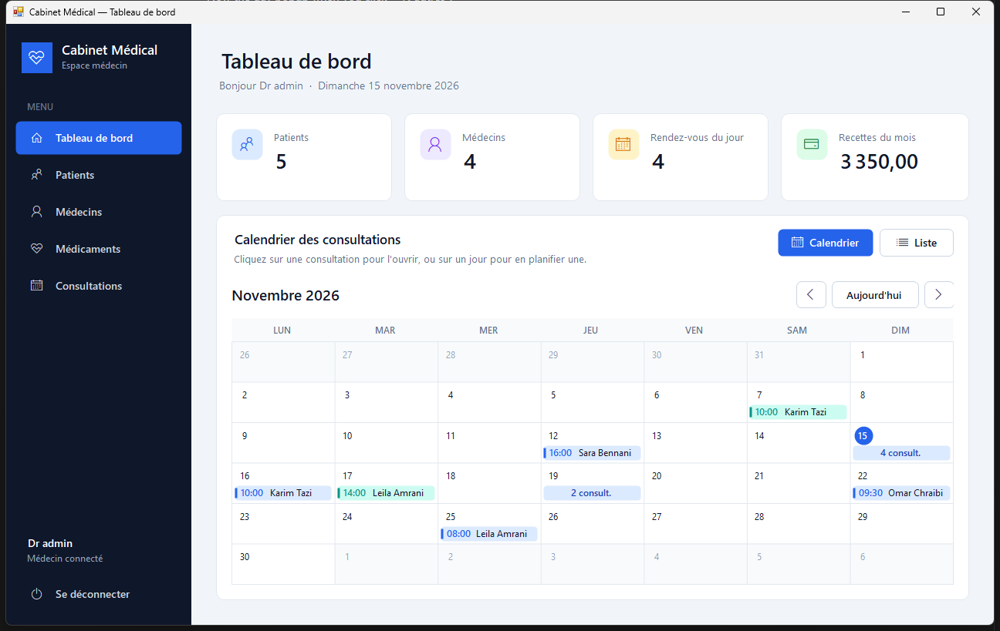
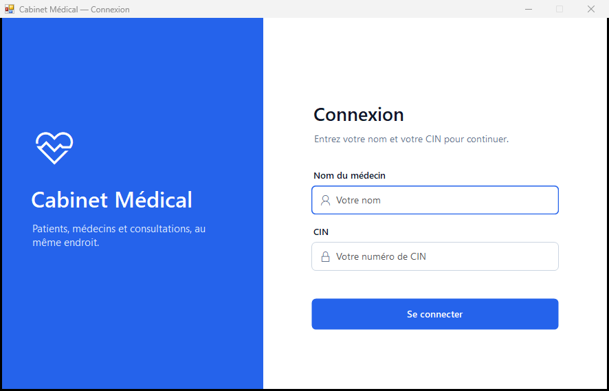
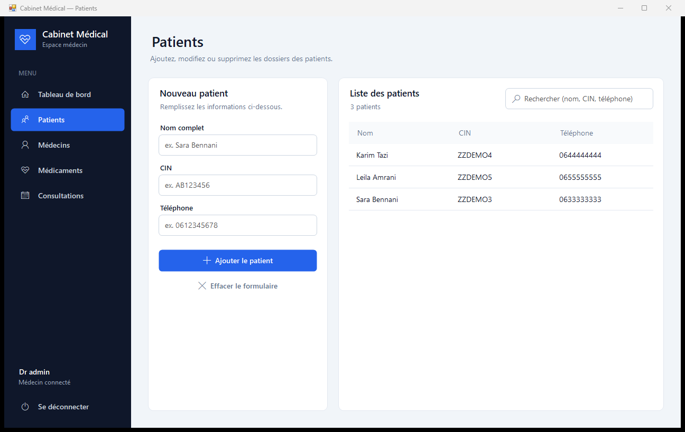
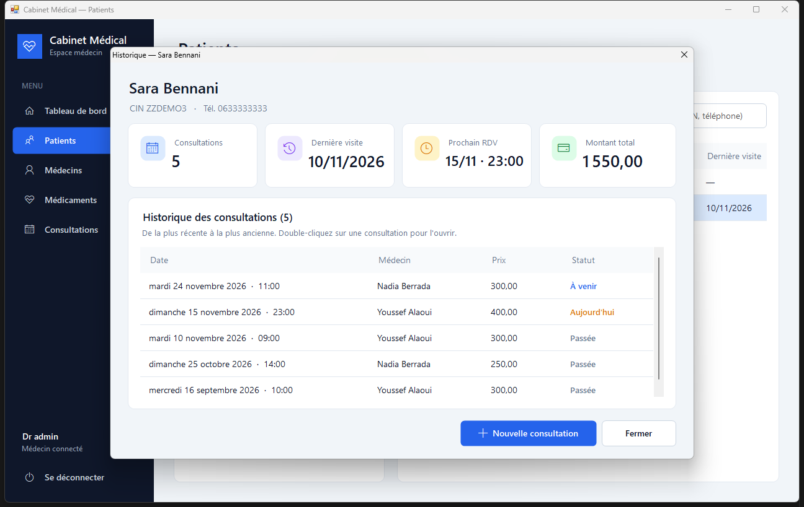
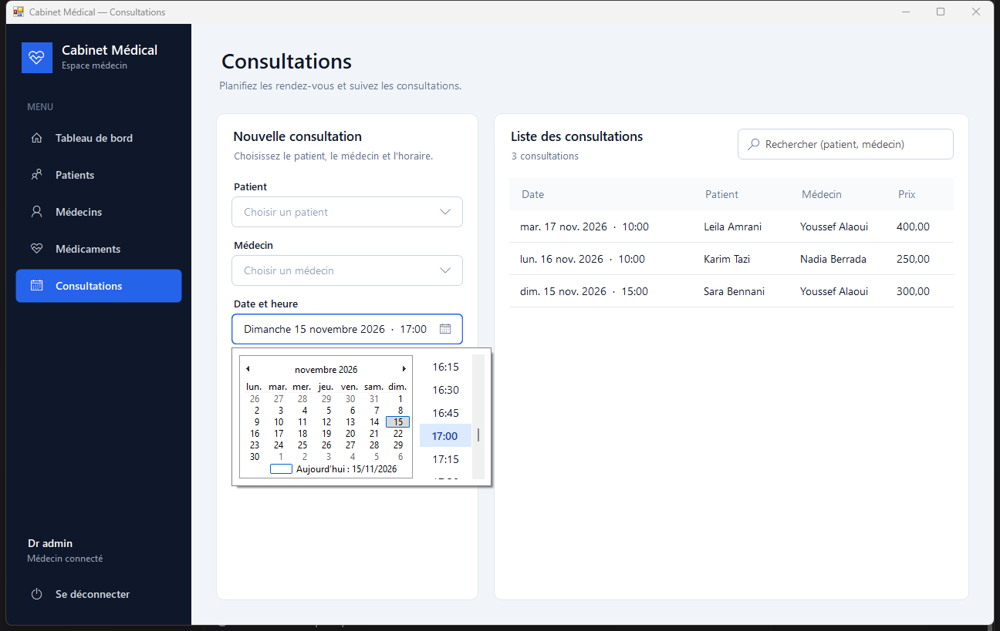

# Cabinet Médical — WinForms / C#

Application de bureau pour gérer un cabinet médical : patients, médecins, médicaments
et consultations, avec un tableau de bord, un calendrier des rendez-vous et l'historique
de chaque patient.



## Fonctionnalités

- **Connexion** des médecins (nom + CIN).
- **Tableau de bord** : nombre de patients et de médecins, rendez-vous du jour,
  recettes du mois, et prochaines consultations affichées **en liste ou en calendrier**.
- **Patients, médecins, médicaments** : ajout, modification, suppression, avec
  recherche instantanée et messages de confirmation dans la page.
- **Consultations** :
  - choix du patient et du médecin dans des listes déroulantes ;
  - sélecteur de date avec calendrier et créneaux de 15 minutes ;
  - **calendrier mensuel** : une pastille colorée par consultation (une couleur par médecin),
    clic sur une consultation pour la modifier, clic sur un jour pour en planifier une.
- **Historique du patient** : nombre de consultations, dernière visite, prochain rendez-vous,
  montant total et liste de toutes ses consultations (passées, du jour, à venir).

## Captures d'écran

| Connexion | Patients |
|---|---|
|  |  |

| Historique d'un patient | Nouvelle consultation |
|---|---|
|  |  |

## Prérequis

- Windows 10 ou 11
- Visual Studio 2019 ou plus récent avec la charge de travail « Développement .NET Desktop »
  (.NET Framework 4.7.2)
- SQL Server Express **LocalDB** (installé avec Visual Studio, ou séparément)

Aucune bibliothèque externe n'est nécessaire : les contrôles graphiques sont écrits en
WinForms standard dans `TEST/Controls/`.

## Installation

1. **Créer la base de données.** Exécutez `database.sql` sur l'instance
   `(localdb)\MSSQLLocalDB`, par exemple avec SQL Server Management Studio ou :

   ```bash
   sqlcmd -S "(localdb)\MSSQLLocalDB" -i database.sql
   ```

   Le script crée la base `gestion_hopital`, ses tables et un médecin de démonstration.

2. **Vérifier la connexion.** Si vous utilisez un autre serveur SQL, modifiez la chaîne
   de connexion `gestion_hopital` dans `TEST/App.config`.

3. **Lancer l'application.** Ouvrez `TEST.sln` dans Visual Studio et appuyez sur F5.

## Connexion

On se connecte avec le **nom** et la **CIN** d'un médecin enregistré.
Avec le script fourni : nom `admin`, CIN `AB12345`.

## Organisation du code

| Fichier | Rôle |
|---|---|
| `TEST/Db.cs` | Accès à la base : requêtes paramétrées, connexions, gestion des erreurs |
| `TEST/Session.cs` | Médecin connecté et petites aides (recherche dans les listes) |
| `TEST/signup.cs` | Écran de connexion |
| `TEST/Form1.cs` | Fenêtre principale, menu latéral et navigation |
| `TEST/accueil.cs` | Tableau de bord |
| `TEST/patient.cs`, `medecin.cs`, `medicament.cs` | Écrans de gestion |
| `TEST/consultation.cs` | Consultations (formulaire, calendrier et liste) |
| `TEST/HistoriquePatient.cs` | Fenêtre d'historique d'un patient |
| `TEST/Controls/Theme.cs` | Couleurs, polices et icônes |
| `TEST/Controls/FlatControls.cs` | Boutons, champs, listes déroulantes, sélecteur de date, cartes, tableaux |
| `TEST/Controls/CalendarView.cs` | Calendrier mensuel des consultations |
| `database.sql` | Création de la base et données de démonstration |

## Sécurité

Toutes les requêtes SQL sont paramétrées (pas d'injection SQL possible) et chaque suppression
demande une confirmation. La connexion par nom + CIN reste simple : pour un usage réel,
ajoutez un vrai mot de passe (haché) aux médecins.
